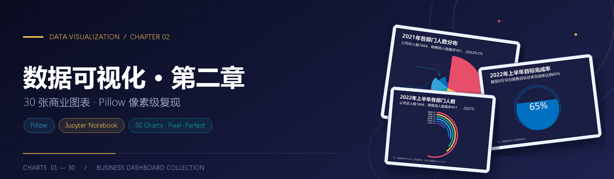
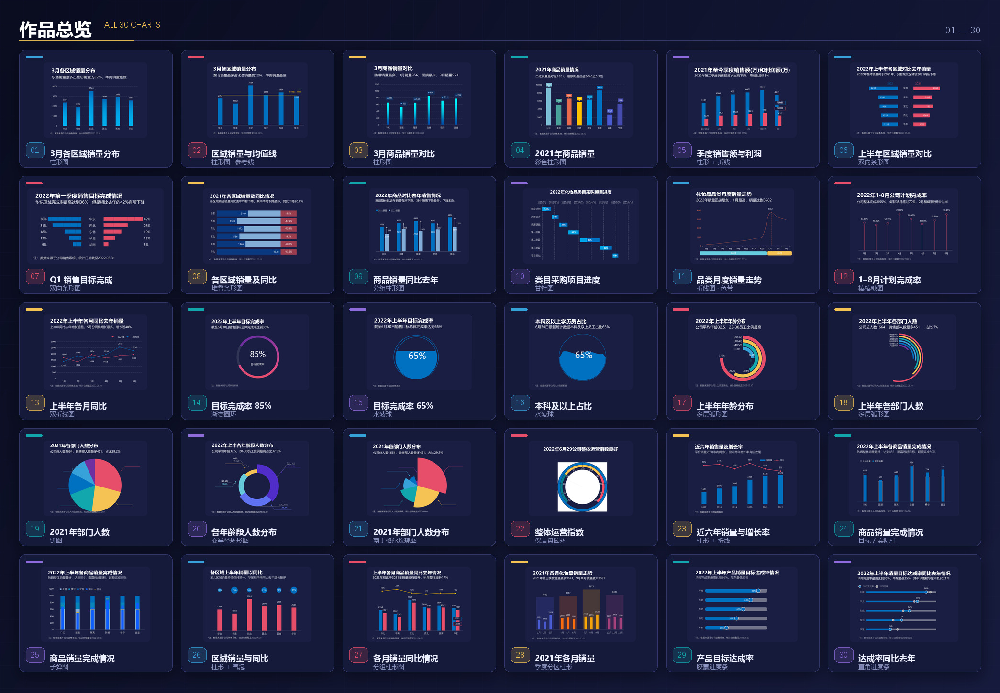
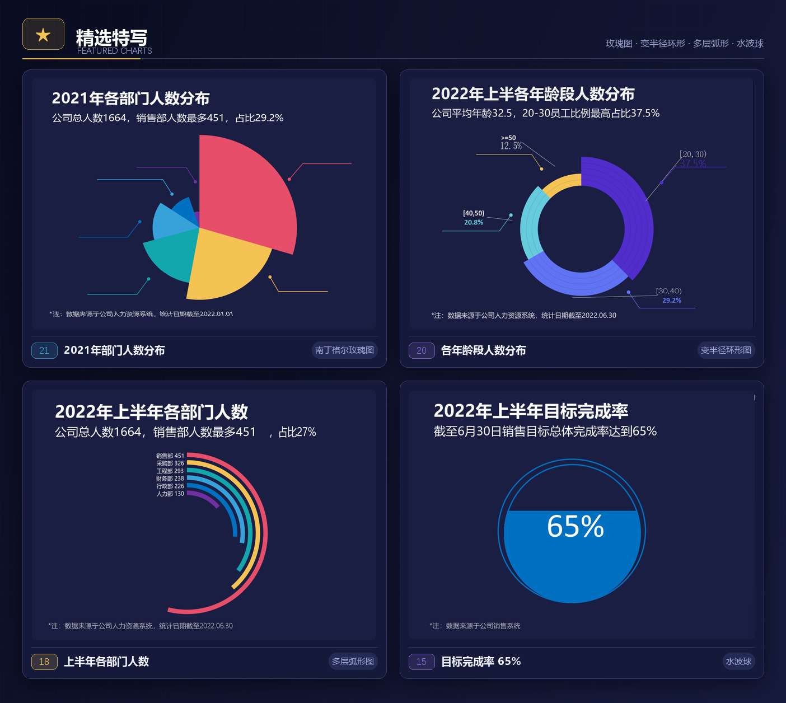
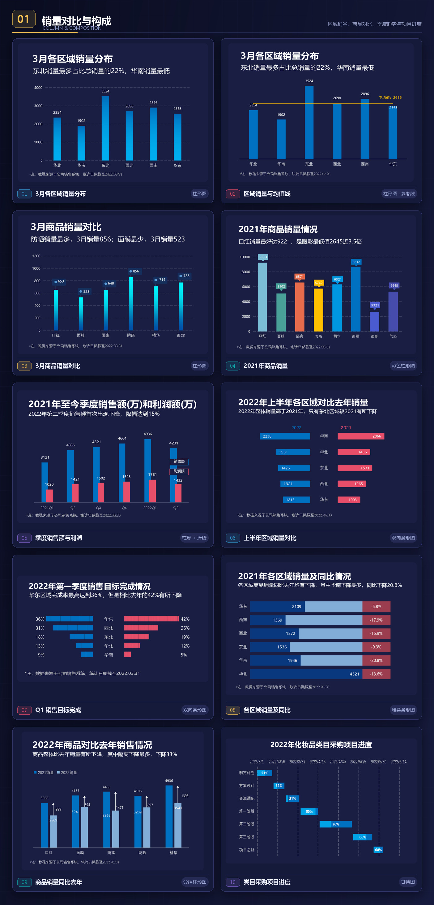
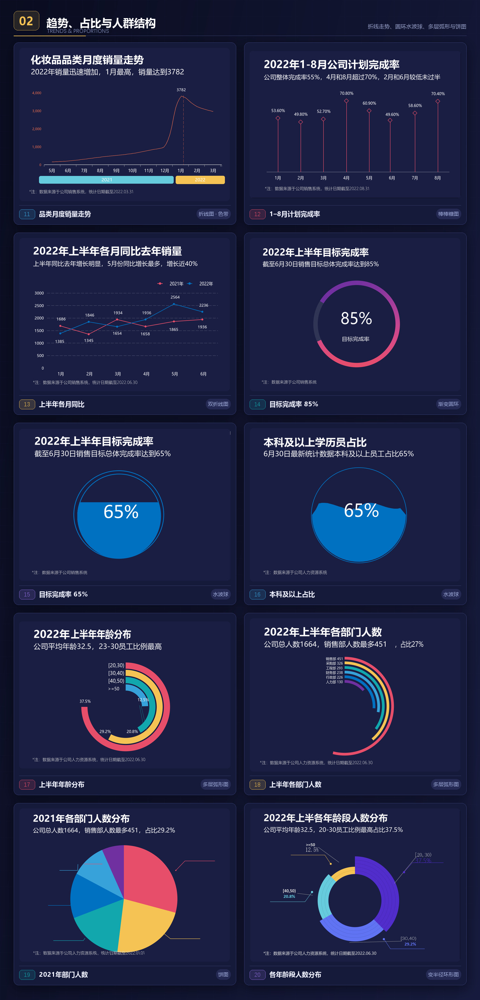
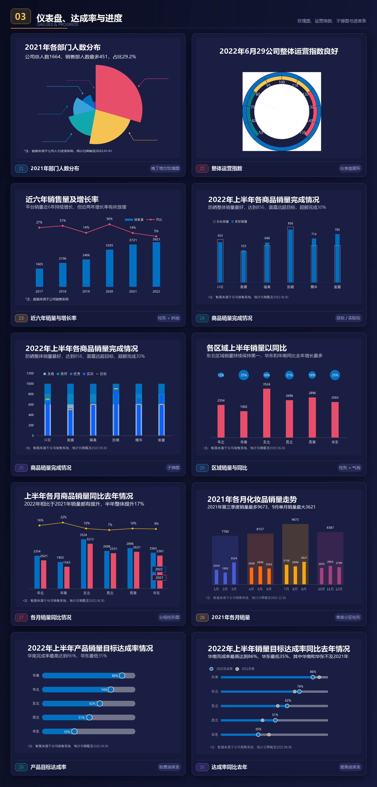

<div align="center">



<br><br>

[](https://www.python.org/)
[](https://pillow.readthedocs.io/)
[](https://jupyter.org/)
[](#overview)
[](#how)

<br>

**用 Pillow 一笔一画绘制的 30 张深蓝商务图表 · 逐像素对齐参考图 · 每个 Cell 独立可运行**

[作品总览](#overview) · [精选特写](#featured) · [分章图集](#gallery) · [快速开始](#start) · [实现要点](#how)

</div>

---

<a name="about"></a>
## ✨ 关于本项目

这不是用 ECharts 或 matplotlib 生成的常规图表，而是直接在画布上**用 Pillow 绘制**的一套商业数据可视化作品集：柱形、折线、双向条形、甘特图、饼图、南丁格尔玫瑰图、渐变圆环、水波球、多层弧形、仪表盘、子弹图、进度条……每一张都完整包含**主标题 + 洞察式副标题 + 数据标签 + 底部注释**，拿来就能放进汇报或仪表盘。

| <div align="center">📊 **30 张**<br>成品图表</div> | <div align="center">📓 **3 个**<br>Jupyter Notebook</div> | <div align="center">🧩 **12+ 种**<br>图表类型</div> | <div align="center">🎯 **1 : 1**<br>参考图对齐</div> |
| :---: | :---: | :---: | :---: |

- **纯 Pillow 绘制** — 不依赖任何绘图框架，几何、渐变、文字排版全部由 `ImageDraw` 完成
- **单元自包含** — 每个 Cell 自带 import、字体加载与绘图函数，单独拎出来也能跑出完整图
- **输出即成品** — 运行后 `display(out)` 内嵌显示，同时保存独立 PNG 文件
- **统一视觉语言** — 深蓝底 `#1A1E43`，五色数据色板，标题 / 副标题 / 注释三段式版式

---

<a name="overview"></a>
## 🖼 作品总览



<div align="center"><sub>图 01 — 30 · 6 × 5 作品墙 · 编号与下方分章图集一一对应</sub></div>

| Notebook | 图表编号 | 主题 |
| :--- | :---: | :--- |
| [第二章（1-10）.ipynb](<第二章（1-10）.ipynb>) | `01 – 10` | 销量对比与构成：区域 / 商品 / 季度 / 项目进度 |
| [第二章（10-20）.ipynb](<第二章（10-20）.ipynb>) | `11 – 20` | 趋势、占比与人群结构：折线 / 圆环 / 水波球 / 多层弧 |
| [第二章（20-30）.ipynb](<第二章（20-30）.ipynb>) | `21 – 30` | 仪表盘、达成率与进度：玫瑰图 / 运营指数 / 子弹图 / 进度条 |

---

<a name="featured"></a>
## ★ 精选特写



<div align="center">
<sub>
<a href="assets/charts/21.png">21 · 南丁格尔玫瑰图</a> 　
<a href="assets/charts/20.png">20 · 变半径环形图</a> 　
<a href="assets/charts/18.png">18 · 多层弧形图</a> 　
<a href="assets/charts/15.png">15 · 水波球</a> —— 点击可查看原始大图
</sub>
</div>

---

<a name="gallery"></a>
## 📊 分章图集

### <a name="g1"></a>`01` 销量对比与构成

> 区域销量、商品对比、季度趋势与采购项目进度 · 柱形 / 条形 / 甘特图



<div align="center"><sub>Chart 01 — 10 · 出自 <a href="第二章（1-10）.ipynb">第二章（1-10）.ipynb</a></sub></div>

<br>

### <a name="g2"></a>`02` 趋势、占比与人群结构

> 折线走势、渐变圆环、水波球、多层弧形与饼图 · 从趋势到结构占比



<div align="center"><sub>Chart 11 — 20 · 出自 <a href="第二章（10-20）.ipynb">第二章（10-20）.ipynb</a></sub></div>

<br>

### <a name="g3"></a>`03` 仪表盘、达成率与进度

> 玫瑰图、运营指数环、子弹图与进度条 · 面向目标管理场景



<div align="center"><sub>Chart 21 — 30 · 出自 <a href="第二章（20-30）.ipynb">第二章（20-30）.ipynb</a></sub></div>

---

<a name="index"></a>
## 🧩 图表类型索引

| 类别 | 代表编号 | 图表形式 |
| :--- | :--- | :--- |
| 对比与构成 | `01` `03` `04` `06` `09` `23` `27` | 柱形图、双向条形图、分组 / 堆叠柱形 |
| 趋势与走势 | `05` `11` `12` `13` `22` `28` | 折线图、双折线、柱线组合、棒棒糖图 |
| 占比与结构 | `17` `18` `19` `20` `21` | 饼图、变半径环形、南丁格尔玫瑰图、多层弧形图 |
| 仪表与目标 | `14` `15` `16` `22` | 渐变圆环、水波球、仪表盘圆环 |
| 进度与达成 | `10` `24` `25` `29` `30` | 甘特图、目标 / 实际柱、子弹图、胶囊与直角进度条 |

---

<a name="start"></a>
## 🚀 快速开始

```bash
git clone <your-repo-url>
cd 数据可视化
pip install pillow numpy jupyter
jupyter notebook
```

1. 打开任意一个 `第二章（*.ipynb）`
2. `Kernel → Restart & Run All`，即可看到 10 张内嵌图表
3. 也可以只运行单个 Cell —— 每个 Cell 完全独立，互不依赖
4. 运行后会在当前目录生成对应的 PNG 成品图

> [!NOTE]
> 字体默认读取 Windows 的微软雅黑 / 等线（`C:/Windows/Fonts/`），代码内已带 macOS 苹方、Linux 文泉驿微米黑的候选路径。若在其他系统运行后出现中文方框，把 Cell 里的 `P = 'C:/Windows/Fonts/'` 换成你的中文字体目录即可。

---

<a name="tree"></a>
## 🗂 目录结构

```text
数据可视化/
├── README.md                    ← 你正在看的页面
├── assets/
│   ├── banner.png               主视觉
│   ├── overview.jpg             30 图作品总览墙
│   ├── featured.jpg             4 图精选特写
│   ├── gallery-01.jpg           图集 01–10
│   ├── gallery-02.jpg           图集 11–20
│   ├── gallery-03.jpg           图集 21–30
│   └── charts/
│       ├── 01.png … 30.png      30 张原始大图（单图可点开）
├── 第二章（1-10）.ipynb          Chart 01 – 10
├── 第二章（10-20）.ipynb         Chart 11 – 20
└── 第二章（20-30）.ipynb         Chart 21 – 30
```

---

<a name="how"></a>
## 🛠 实现要点

- **4× 超采样 + BOX 回缩**：几何先在 4 倍画布上绘制，再用 `Image.Resampling.BOX` 缩回原尺寸，圆弧与斜线边缘干净、无脏边
- **精确的边界覆盖**：矩形右下端点用 `(x1+1)*S-1`，避免超采样后少画 1 像素
- **墨迹框贴图**：文字先按字形墨迹包围盒裁切，再缩放到参考图的实测 bbox，标题按原图留白分段处理
- **字体分工**：标题用微软雅黑 Bold，副标题用常规体，注释用 Light / 等线，数字百分比用 Calibri 细体
- **兼容新旧 Pillow**：`RS = getattr(Image, 'Resampling', Image)`，从源头避开 `Image.BOX` 之类的弃用告警
- **统一底色**：所有图表背景均为 `(26, 30, 67)`，与拼图卡片深蓝主题一脉相承

---

<a name="list"></a>
## 📋 完整清单

<details>
<summary><b>展开 30 张图表清单（编号 / 标题 / 类型 / 原始大图）</b></summary>

| # | 标题 | 类型 | 大图 |
| :---: | :--- | :--- | :---: |
| 01 | 3月各区域销量分布 | 柱形图 | [查看](assets/charts/01.png) |
| 02 | 区域销量与均值线 | 柱形图 · 参考线 | [查看](assets/charts/02.png) |
| 03 | 3月商品销量对比 | 柱形图 | [查看](assets/charts/03.png) |
| 04 | 2021年商品销量 | 彩色柱形图 | [查看](assets/charts/04.png) |
| 05 | 季度销售额与利润 | 柱形 + 折线 | [查看](assets/charts/05.png) |
| 06 | 上半年区域销量对比 | 双向条形图 | [查看](assets/charts/06.png) |
| 07 | Q1 销售目标完成 | 双向条形图 | [查看](assets/charts/07.png) |
| 08 | 各区域销量及同比 | 堆叠条形图 | [查看](assets/charts/08.png) |
| 09 | 商品销量同比去年 | 分组柱形图 | [查看](assets/charts/09.png) |
| 10 | 类目采购项目进度 | 甘特图 | [查看](assets/charts/10.png) |
| 11 | 品类月度销量走势 | 折线图 · 色带 | [查看](assets/charts/11.png) |
| 12 | 1–8月计划完成率 | 棒棒糖图 | [查看](assets/charts/12.png) |
| 13 | 上半年各月同比 | 双折线图 | [查看](assets/charts/13.png) |
| 14 | 目标完成率 85% | 渐变圆环 | [查看](assets/charts/14.png) |
| 15 | 目标完成率 65% | 水波球 | [查看](assets/charts/15.png) |
| 16 | 本科及以上占比 | 水波球 | [查看](assets/charts/16.png) |
| 17 | 上半年年龄分布 | 多层弧形图 | [查看](assets/charts/17.png) |
| 18 | 上半年各部门人数 | 多层弧形图 | [查看](assets/charts/18.png) |
| 19 | 2021年部门人数 | 饼图 | [查看](assets/charts/19.png) |
| 20 | 各年龄段人数分布 | 变半径环形图 | [查看](assets/charts/20.png) |
| 21 | 2021年部门人数分布 | 南丁格尔玫瑰图 | [查看](assets/charts/21.png) |
| 22 | 整体运营指数 | 仪表盘圆环 | [查看](assets/charts/22.png) |
| 23 | 近六年销量与增长率 | 柱形 + 折线 | [查看](assets/charts/23.png) |
| 24 | 商品销量完成情况 | 目标 / 实际柱 | [查看](assets/charts/24.png) |
| 25 | 商品销量完成情况 | 子弹图 | [查看](assets/charts/25.png) |
| 26 | 区域销量与同比 | 柱形 + 气泡 | [查看](assets/charts/26.png) |
| 27 | 各月销量同比情况 | 分组柱形图 | [查看](assets/charts/27.png) |
| 28 | 2021年各月销量 | 季度分区柱形 | [查看](assets/charts/28.png) |
| 29 | 产品目标达成率 | 胶囊进度条 | [查看](assets/charts/29.png) |
| 30 | 达成率同比去年 | 直角进度条 | [查看](assets/charts/30.png) |

</details>

---

<div align="center">

<sub>图表为数据可视化学习与实践作品，所用数据均为演示数据。</sub>

<br>

**⭐ 觉得好看就点个 Star 吧 ⭐**

</div>
